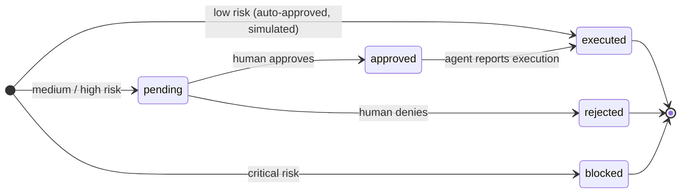
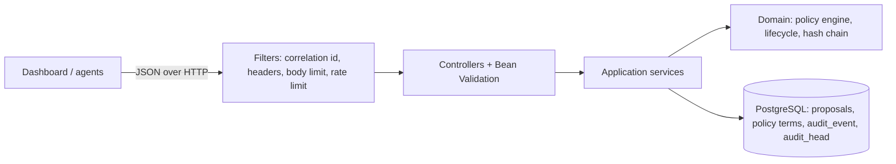

# AgentLedger

An approval gate and tamper-evident audit trail for AI agent actions. Before an agent touches a
real system it submits a **proposal** (agent, action, target, reason). AgentLedger classifies the
proposal by risk, routes it (auto-approve, human review, or hard block), and records every step in
an append-only, SHA-256 hash-chained ledger that anyone can verify.

> This is a reference implementation. Execution is simulated: AgentLedger never calls an external
> system itself. See [Limitations](#limitations).

## Contents

- [Risk model and policies](#risk-model-and-policies)
- [Proposal lifecycle](#proposal-lifecycle)
- [Hash-chained audit trail](#hash-chained-audit-trail)
- [API](#api)
- [Running](#running)
- [Configuration](#configuration)
- [Project layout](#project-layout)
- [Architecture and decisions](#architecture-and-decisions)
- [Running in production](#running-in-production)
- [Limitations](#limitations)

## Risk model and policies

The policy engine evaluates `action + target + reason` (the agent name is ignored, so an agent
cannot game its own classification). Every rule that fires is recorded; the most severe one decides.

| Tier | Rule | Default terms | Matching | Routing | Initial status |
|------|------|---------------|----------|---------|----------------|
| `critical` | `mandatory-destructive` (cannot be disabled) | delete, drop, remove, erase, destroy, truncate, wipe, purge, admin(istrator) | whole words incl. inflections (`deleting`, `dropped`, `removal`) | **Block**; the review API refuses approval | `blocked` |
| `high` | `configured-high` | export, email, permission, role, update, write, send | case-insensitive substring | Human review | `pending` |
| `medium` | `configured-medium` | refund, payment | case-insensitive substring | Human review | `pending` |
| `low` | `default-low` (no rule fired) | — | — | Auto-approve, execution simulated | `executed` |

Why two matching strategies: configured terms only send a proposal to a human, so over-matching is
the safe failure mode (`overwrite` matches `write`). The mandatory rule is a block nobody can
override, so it matches whole words to avoid false positives such as `dropdown`.

Medium and high terms are editable in **Policy settings** (or `PUT /api/policies`): up to 30 terms
per tier, 2–40 characters each, normalized to lower case and de-duplicated. Every effective change
is written to the ledger as a `policy_updated` entry.

The engine (`domain.policy`) is plain Java with no Spring dependency. New rule types implement
`PolicyRule` (`id()` + `evaluate(ProposalContent)`) and are passed to `PolicyEngine`.

## Proposal lifecycle



Transitions are validated in the domain (`ProposalStatus.canTransitionTo`) and persisted with a
compare-and-set update (`WHERE status = :expected`), so two concurrent reviews cannot both succeed:
the loser gets `409 Conflict`.

## Hash-chained audit trail

Every state change and its ledger entry commit in the same transaction. Each entry stores:

```
seq | action_id | event | actor | detail | created_at | prev_hash | hash
hash = SHA-256( "agentledger/v1" + length-prefixed(seq, action_id, event, actor, detail, created_at, prev_hash) )
```

- The first entry links to the genesis hash (`000…0`); each later entry links to the previous hash.
- Fields are length-prefixed, so values containing separators cannot collide.
- Appends are serialized by locking a single `audit_head` row (`SELECT … FOR UPDATE`), giving a
  contiguous sequence even under concurrent writers.
- The table is **append-only at the database level**: a PostgreSQL trigger rejects `UPDATE`,
  `DELETE` and `TRUNCATE` (an equivalent H2 trigger covers the dev profile and tests). The
  application has no update/delete code path for it.
- `GET /api/audit/verify` recomputes every hash and link, and compares the result with the stored
  head, so edited, reordered, removed or truncated entries are reported with the first bad `seq`.

Publishing `head_hash` somewhere outside the database (a ticket, a log sink, a timestamping
service) anchors the chain: someone with full database access could otherwise rewrite and re-hash
the whole history.

## API

All errors are [RFC 9457 Problem Details](https://www.rfc-editor.org/rfc/rfc9457)
(`application/problem+json`). For compatibility with the previous API each problem also carries an
`error` member with the message. JSON fields are `snake_case`; timestamps are ISO-8601 UTC.

| Method | Path | Description |
|--------|------|-------------|
| `GET` | `/api/actions?status=&limit=` | Proposals, newest first (`limit` 1–1000, default 500) |
| `POST` | `/api/actions` | Evaluate and record a proposal → `201` + `Location` |
| `GET` | `/api/actions/{id}` | One proposal |
| `GET` | `/api/actions/{id}/events` | Its ledger entries, newest first |
| `POST` | `/api/actions/{id}/review` | `{"decision":"approve"\|"deny","reviewer?","note?"}` |
| `POST` | `/api/actions/{id}/execution` | Agent reports an approved action as executed (`{"actor?","note?"}`) |
| `GET` | `/api/summary` | `total`, `pending`, `approved`, `executed`, `blocked` (blocked + rejected) |
| `GET` / `PUT` | `/api/policies` | `{"medium":[…],"high":[…]}`; `GET` also lists the fixed `critical` terms |
| `GET` | `/api/audit/verify` | `{"valid","checked","head_hash","broken_at","reason"}` |
| `GET` | `/api/health` | Legacy health (`{"status":"ok"}`), backed by Actuator |
| `GET` | `/actuator/health`, `/actuator/health/{liveness,readiness}` | Probes |

```bash
curl -s -X POST localhost:8080/api/actions -H 'Content-Type: application/json' \
  -d '{"agent":"Ops Assistant","action":"Refund payment","target":"payment:pay_1","reason":"Duplicate charge"}'
# {"id":6,"risk":"medium","status":"pending","policy_rule":"configured-medium", ...}

curl -s -X POST localhost:8080/api/actions/6/review -H 'Content-Type: application/json' \
  -d '{"decision":"approve","reviewer":"Ana","note":"Verified in the PSP dashboard"}'
```

| Status | When |
|--------|------|
| `400` | Validation failure, malformed JSON, invalid policy, bad path/query parameter |
| `404` | Unknown proposal or route |
| `409` | Approving a blocked action, reviewing a non-pending one, concurrent change |
| `413` | Body larger than `AGENTLEDGER_MAX_BODY_BYTES` |
| `415` | Write without `Content-Type: application/json` |
| `429` | Write rate limit exceeded (`Retry-After` header) |

## Running

Requirements: JDK 21. Maven is provided by the wrapper (`./mvnw`).

```bash
# 1. Zero infrastructure: file-based H2 under ./data
SPRING_PROFILES_ACTIVE=dev ./mvnw spring-boot:run
# open http://localhost:8080

# 2. Full stack with PostgreSQL (Docker)
cp .env.example .env        # set POSTGRES_PASSWORD
docker compose up --build
# open http://localhost:8080

# 3. Against an existing PostgreSQL
DATABASE_URL=jdbc:postgresql://localhost:5432/agentledger \
DATABASE_USERNAME=agentledger DATABASE_PASSWORD=secret ./mvnw spring-boot:run
```

Quality gate (formatting, compilation with `-Werror`, tests, coverage):

```bash
./mvnw verify            # tests run on H2 in PostgreSQL mode
./mvnw spotless:apply    # format (google-java-format)

# same suite against a real PostgreSQL (CI does this too)
SPRING_DATASOURCE_URL=jdbc:postgresql://localhost:5432/agentledger_test \
SPRING_DATASOURCE_USERNAME=agentledger SPRING_DATASOURCE_PASSWORD=secret ./mvnw test
```

The test suite **cleans the target schema**; point it at a dedicated database.

## Configuration

| Variable | Default | Purpose |
|----------|---------|---------|
| `SERVER_PORT` | `8080` | HTTP port |
| `DATABASE_URL` | `jdbc:postgresql://localhost:5432/agentledger` | JDBC URL |
| `DATABASE_USERNAME` / `DATABASE_PASSWORD` | `agentledger` / `agentledger` | Credentials (always override in production) |
| `DATABASE_POOL_SIZE` | `10` | Hikari pool size |
| `SPRING_PROFILES_ACTIVE` | — | `dev` = embedded H2 file database |
| `AGENTLEDGER_SEED_DEMO_DATA` | `true` | Seed sample proposals into an empty database |
| `AGENTLEDGER_MAX_BODY_BYTES` | `16384` | Max API request body |
| `AGENTLEDGER_RATE_LIMIT_ENABLED` | `true` | Per-client token bucket on API writes |
| `AGENTLEDGER_RATE_LIMIT_CAPACITY` | `30` | Burst size |
| `AGENTLEDGER_RATE_LIMIT_REFILL_PER_MINUTE` | `30` | Sustained writes per minute |
| `LOG_FORMAT` | `ecs` | Structured console logs (`ecs`, `logstash`, `gelf`) |
| `SERVER_FORWARD_HEADERS_STRATEGY` | `none` | `framework` only behind a trusted proxy |

## Project layout

```
src/main/java/io/github/codebyjuliamendes/agentledger
├── domain/                 # pure Java, no framework
│   ├── policy/             # PolicyEngine, PolicyRule, KeywordRule, DestructiveActionRule, RiskPolicy
│   ├── proposal/           # ActionProposal, ProposalStatus (transitions), ReviewDecision, ProposalException
│   └── audit/              # AuditChain (hashing), ChainVerifier, AuditEntry, AuditHead
├── application/            # use cases (ProposalService, PolicyService, AuditLedger) + store ports
├── infrastructure/persistence/  # JdbcClient adapters, H2 append-only trigger
├── web/                    # REST controllers, DTOs, Problem Details handler
│   └── filter/             # correlation id, security headers, body limit, rate limit
└── config/                 # typed properties, clock, demo seeder
src/main/resources
├── db/migration/common     # portable schema (Flyway)
├── db/migration/{postgresql,h2}  # vendor-specific append-only triggers
└── static/                 # dashboard (HTML, CSS, JS, self-hosted fonts, mark-al.svg)
```

## Architecture and decisions



- **Java 21 + Spring Boot 3.5.** The product is an audit/compliance component: strong typing,
  mature transaction management and a long-term-supported runtime matter more than start-up time.
  Records model immutable values; sealed types (`PolicyOutcome`, `ChainVerification`,
  `ProposalException`) give exhaustive `switch` checks, so adding an outcome is a compile error until
  every caller handles it.
- **Framework-free domain.** Policies, transitions and hashing are unit-tested without Spring and
  can be reused (for example inside an agent SDK).
- **Spring JDBC (`JdbcClient`) instead of an ORM.** The ledger depends on precise SQL (row locks,
  compare-and-set updates, keyset pagination) that is clearer written out than hidden behind a
  mapping layer; the aggregates are small.
- **PostgreSQL in production, H2 (PostgreSQL mode) for dev and default tests.** No Docker is
  needed to build or test. Migrations are portable except the append-only triggers, which Flyway
  loads per vendor. CI runs the full suite against both H2 and a real PostgreSQL.
- **Problem Details + legacy `error` member**, so the existing UI contract keeps working.
- **No external assets.** Fonts are self-hosted (SIL OFL, see `static/fonts/OFL.txt`) and all
  scripts/styles are same-origin, which allows a strict CSP without `unsafe-inline`.

## Running in production

- Run the container image (multi-stage, layered jar, non-root `app` user, `HEALTHCHECK` on
  readiness). Use `/actuator/health/liveness` and `/actuator/health/readiness` for orchestrator probes.
- Set `AGENTLEDGER_SEED_DEMO_DATA=false` and real database credentials from a secret store.
- Terminate TLS at a proxy; enable `SERVER_FORWARD_HEADERS_STRATEGY=framework` only if that proxy
  is trusted (it affects the client address used by the rate limiter). HSTS is sent on HTTPS requests.
- Logs are JSON (ECS) on stdout with `correlation_id`; send `X-Request-Id` to correlate with
  upstream systems (the id is echoed back).
- Grant the application role only `SELECT, INSERT` on `audit_event`; keep migration/DDL
  privileges in a separate role so the trigger cannot be dropped by the app.
- Anchor `head_hash` from `/api/audit/verify` periodically outside the database.
- The rate limiter is per instance; with several replicas put limits in the gateway as well.

## Limitations

- **No authentication or authorization.** Reviewer names are free text and anyone who can reach
  the API can approve or change policies. Put AgentLedger behind an authenticating proxy (OIDC) and
  map identities to the `reviewer`/actor fields before exposing it.
- Keyword rules are heuristics, not a security boundary; real deployments need per-tool policies
  (structured action types, argument checks, allow-lists).
- Execution is simulated; there is no connector that wraps agent tool calls yet.
- The hash chain proves integrity relative to an anchored head; it is not a signature. Signing
  entries (e.g. with a KMS key) would add non-repudiation.
- Demo seeding is not coordinated across replicas; enable it on a single instance only.
